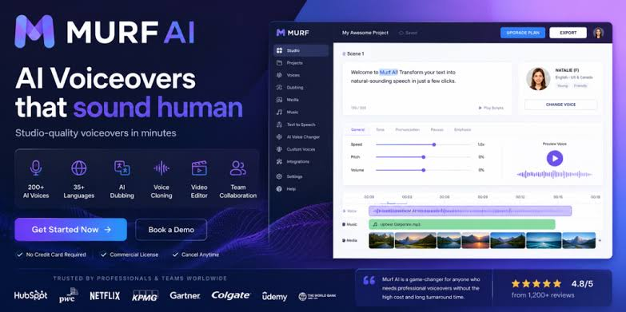

# Murf Studio

Murf Studio is the place you write a line and hear it back as speech. Murf Voice Changer is the other half: you already have a recording, and you want it in a different voice. murf tts is the name people use for the text path. murf voice ai and murf ai voice are the same product family: studio edits, cloning, and a streaming voice for an agent.

The brief describes hundreds of synthetic voices across 35 or more languages, studio editing, voice cloning, and fast streaming it calls Murf Falcon. A free trial is included. Pay as you go starts at $0.01 per 1,000 characters. Enterprise is custom. This page does not add a monthly price the brief does not list.

The same brief also describes Murf electric bicycles from a California maker founded in 2016. That is a different brand. This README is the voice studio, not a bike shop.


## Overview

The files here are companion libraries. [client.py](client.py) is the Python class `Murf` and the async class `AsyncMurf`. The key defaults to `MURF_API_KEY`. `pyproject.toml` names the package `murf` at version `2.3.0` and lists Python 3.8 through 3.12. That package talks to the API. It does not install the Murf Studio website.

A key belongs in an environment variable, not in a screenshot and not in a chat. Losing the key is how a trial gets spent by someone else.

## Features

Murf Studio is for a script you will play later: an ad, a lesson, a localization pass. Murf Voice Changer is for audio you already recorded. murf tts is the generate call. murf voice ai is the set of voices you pick from. murf ai voice is the result you download or stream.

| Plan | What the brief lists |
| --- | --- |
| Free trial | Try the studio before you pay |
| Pay as you go | Starts at $0.01 per 1,000 characters |
| Enterprise | Custom, not a number on this page |

| Call | Path in the client |
| --- | --- |
| Studio file | v1/speech/generate |
| Stream | v1/speech/stream |
| Voice change | v1/voice-changer/convert |
| Voice list | GET /v1/speech/voices |

The companion studio in this tree is a local app with its own engines. It is not the Murf account. Do not treat a local profile as a Murf voice id.

### Multi-Engine Voice Cloning

Cloning in Murf Studio starts from a sample and a voice you name. The brief lists voice cloning as a product feature. The local companion exposes `INSTRUCT_ENGINES` in [engines.ts](engines.ts): `qwen_custom_voice`, `qwen_voice_design`, and `omnivoice`. `engineSupportsInstruct` is true only for those three. Other engines in that file ignore a style sentence. That rule is the companion, not a Murf model switch.

### Emotions & Paralinguistic Tags

A style word on a Murf voice is a studio control. The companion's instruct field is free prose for some engines and a closed word list for OmniVoice. If the engine raises on a phrase, the phrase was outside its list. Shorten it. Do not keep retrying a paragraph of stage directions.

### Post-Processing Effects

[effectsStore.ts](stores/effectsStore.ts) is `useEffectsStore` for the local editor. Pitch, space, and level belong after the take is clean. A noisy sample will still be noisy after a voice change. Record again before you stack effects.

### Unlimited Generation Length

Long scripts should be split. The generate call is one utterance. A chapter is many calls. Stitch the files in the editor. One giant request is how a job dies in the middle and you lose the start.

### Generation Versions

Keep the take you liked. `stores/generationStore.ts` holds generation state for the companion UI. A new variation does not delete the previous file unless you delete it. Name the keeper before you render ten more.

### Async Generation Queue

`AsyncMurf` is the async Python client in the same `client.py`. Use it when the caller is already async. The companion hook [useGeneration.ts](hooks/useGeneration.ts) posts through `apiClient.generateSpeech` and then refreshes the `history` query. That hook is the local queue, not the Murf account queue.

### Voice Profile Management

A Murf voice id looks like `en-US-natalie`, or the short name `natalie`. The client docs say to look ids up with `GET /v1/speech/voices`. A profile in the local app is a different object. `hooks/useProfiles.ts` loads those local profiles. Do not paste a local file name into `voice_id`.

### Stories Editor

`stores/storyStore.ts` is the multi-line story state in the companion. Murf Studio's own timeline is the website editor. Use the website for a Murf project. Use the companion store only if you are running that local app.

### Global Dictation & Voice Input

Dictation is speech in, not speech out. murf tts is speech out. If you dictate a script, read it back with a voice before you publish. The dictated line is text. The voice is a second step.

### Speech-to-Text

`hooks/useTranscription.ts` is the companion transcription hook. Murf Voice Changer can return a transcription when `return_transcription` is set on `convert`. Those are two different tools. A transcript is text you can edit. It is not the audio.

### Captures

A capture is a take you keep. Name it after the scene. A folder of untitled wav files is how the wrong line gets exported. `stores/playerStore.ts` is the companion player. `hooks/useAudioPlayer.ts` plays a take. Listen on headphones before you send the file to a video editor.

### Agent Voice Output

Streaming is the agent path. The brief calls that fast path Murf Falcon. In the Python client the method is `text_to_speech.stream`. The file path for a finished studio file is `text_to_speech.generate`. An agent wants the stream. A video wants the file.

### Voice Personalities

Style, rate, and pitch are personality knobs. On `convert`, `style`, `rate`, `pitch`, `retain_accent`, and `retain_prosody` are optional. Leave accent and prosody on when the joke is the speaker's rhythm. Turn them down when you want the target voice to take over.

### Model Management

`version/version.py` is the SDK version module. It is not a list of Murf models. The voice list endpoint is the model picker for the API. The companion's engine list is `engines.ts`. Do not mix the two names in one request.

### GPU Support

The local companion can use a GPU. `docker-compose.rocm.yml` is the ROCm compose file next to `docker-compose.yml`. Murf Studio in the browser does not need that GPU. The cloud voice is rendered on Murf's side. The compose files are for the companion, and this folder does not include the image build that would make them boot.

## API

[tts/client.py](tts/client.py) is `text_to_speech.generate` and `text_to_speech.stream`. `generate` posts `v1/speech/generate`. A voice id is required in the sense that you pass one. Locale examples in the file are `en-US` and `en-UK`. The response type lives in `types/generate_speech_response.py`. `types/api_voice.py` is the voice object.

[changer/client.py](changer/client.py) is `voice_changer.convert`. It posts `v1/voice-changer/convert`. You pass `voice_id` and either `file` or `file_url`. `channel_type` is `STEREO` or `MONO`. `encode_output_as_base_64` adds a base64 copy next to the url. `audio_duration` of 0 is ignored, and the note in the file says duration targeting is a Gen2 behavior. `sample_rate` is a float here.

```python
client = Murf()
changed = client.voice_changer.convert(voice_id="en-US-natalie", file_url=audio_url)
```

`Murf()` with no key reads `MURF_API_KEY`. The snippet does not create an account. `audio_url` has to be a file the API can read. Do not point it at a private disk path and expect a cloud convert.

### MCP server

The companion can speak for an agent through its own API. `api/DefaultService.ts` is the class `DefaultService`, and `generateSpeechGeneratePost` is one of its methods. That service is the local app. It is not `https://api.murf.ai`. Imports under `@/lib` will not resolve in this flattened tree.

## Async Client

Use `AsyncMurf` when you await. `await client.voice_changer.convert(...)` is the async shape. Do not share one sync client across threads and call it async. The sync class is `Murf`.

A stream that you do not read will sit open. Close it when the agent turn ends. A generate call that you never download leaves a file url you should still treat as private, because the line you typed is in that audio.

## Exception Handling

[bad_request_error.py](errors/bad_request_error.py) is `BadRequestError` with status 400. [unauthorized_error.py](errors/unauthorized_error.py) is `UnauthorizedError` with status 401. `errors/payment_required_error.py` is `PaymentRequiredError` with status 402. `errors/forbidden_error.py` is `ForbiddenError`. These classes import `ApiError` from a core module that is not in this folder, so importing them here will fail until that module is restored.

400 means the body was wrong: a missing voice, a bad channel type, a file the API could not read. 401 means the key was missing or wrong. 402 means the account needs payment. The pay-as-you-go rate in the brief is $0.01 per 1,000 characters. A 402 is that meter, not a bug in the voice. Fix the key before you retry a 401. Retrying a 401 in a loop only makes noise.

## Advanced

[region/region.py](region/region.py) defines `MurfRegion`: `DEFAULT`, `GLOBAL`, `US_EAST`, `US_WEST`, `EU_CENTRAL`, `IN`, `JP`, `AU`, `KR`, `ME`, `SA_EAST`, `UK`, and `CA`. `region/environment.py` maps those to hostnames such as `global.api.murf.ai` and `us-east.api.murf.ai`. The stream docstring lists a higher concurrency number for US-East (15) and 2 for the other regions it prints. Pick a region near the listener when latency matters. Leave the default when you do not know.

| Region code | What the stream note says |
| --- | --- |
| GLOBAL | Routes to the nearest server |
| US_EAST | Concurrency 15 in that note |
| US_WEST, IN, CA, KR, ME, JP, AU, EU_CENTRAL | Concurrency 2 in that note |

The websocket base in the environment file is under `/v1/speech`. Use it for stream. Use `v1/speech/generate` when you want a file.

### Retries

Retry a network drop. Do not retry 401 or 400 without changing the request. A 402 will not succeed because you retried faster. Wait until the account can pay, or shorten the script so the trial still covers it.

### Timeouts

A long studio line needs a longer timeout than a one-sentence agent reply. Set the timeout on the client, and override it on the one slow call. A timeout that is too short looks like a failed voice. It is a clock.

### Custom Client

You can pass your own HTTP client into the SDK wrapper. That is for a proxy or a test. It is not a second Murf Studio. `client/base_client.py` is the base class `Murf` extends. Read it before you replace the transport. The generated types assume the Murf response shape.

## Operations

The workflow node is [Murf.node.ts](nodes/Murf.node.ts). `package.json` names it `n8n-nodes-murf` at version `0.1.3`. Node must be 20.15 or newer. Scripts are `build`, `dev`, `format`, `lint`, and `lintfix`. There is no `test` script. `build` deletes `dist`, runs `tsc`, and runs `gulp build:icons`. `dist` is not in this tree, and `scripts/gulpfile.js` still needs the gulp package installed, so `npm run build` will not finish here. `scripts/eslintrc.js` is the lint config. `publish.yml` is the publish workflow. `Murf.node.json` is the node metadata. `tsconfig.json` is the TypeScript config. `extensions.json` is an editor recommendation. `biome.json` is the companion linter config, not the node linter.

### Text to Speech

[TextToSpeechExecute.ts](speech/TextToSpeechExecute.ts) posts `https://api.murf.ai/v1/speech/generate`. `speech/TextToSpeechDescription.ts` is the field list for that operation. This is murf tts in a workflow: text in, a file url out. Match the voice id to the language of the line.

### Voice Changer

[VoiceChangerExecute.ts](voice/VoiceChangerExecute.ts) is `executeVoiceChanger`. It reads `voiceId` as an object with `value` or as a string, and throws `Invalid voice ID parameter` otherwise. It requires `murfApi` credentials and throws `No credentials got returned!` when they are missing. It posts `https://api.murf.ai/v1/voice-changer/convert` with `voice_id`, `format`, `channel_type`, `sample_rate`, and `encode_output_as_base64`. Input is `file` (binary) or `url` (`file_url`). `voice/VoiceChangerDescription.ts` describes those fields. That operation is Murf Voice Changer. It is not a bike setting and not a local engine name.

### Translation

[TranslationExecute.ts](translations/TranslationExecute.ts) is the translate step. `translations/TranslationDescription.ts` lists its fields. Translate, then speak. A voice recorded for one language will not automatically fit another. The brief's localization story is this order: text, then murf ai voice.

### Dubbing

[DubbingExecute.ts](dubbing/DubbingExecute.ts) and `dubbing/DubbingDescription.ts` cover a dubbing job. `dubbing/dubbing_client.py` is the Python dubbing client. [MurfDubApi.credentials.ts](credentials/MurfDubApi.credentials.ts) is the dubbing credential. The speech credential is separate. A dubbing key in the speech field will fail. [MurfApi.credentials.ts](credentials/MurfApi.credentials.ts) is the speech, changer, and translation credential.

## Node Structure

The node groups are voice, speech, dubbing, and translations. Each group has a description file and an execute file. The description is the form. The execute file is the HTTP call. Edit the path in the execute file only if the API path actually changed. Guessing a path returns 400.

## Credentials

Two credentials: `murfApi` and the dubbing credential. Both are API keys. Store them in the workflow secret store. `MURF_API_KEY` is the environment name the Python client reads. Do not put either key in `cli.json` or in a compose file you commit.

## Compatibility

The node declares `n8nNodesApiVersion` 1 and expects n8n 1 or newer, as the package text says. The Python package expects 3.8 or newer. The companion app is a separate Node project. Its package file is not the `package.json` in this folder. Do not run the n8n build and expect the companion UI.

## Usage

Create the key on the Murf account page. Set `MURF_API_KEY`. Call `generate` for a file or `convert` for a voice change. Download the url the response gives you. For a workflow, drop in the node, pick the operation, and select a voice. For the website, use the button below. The libraries do not replace the studio login.

## Development

Build the node only if you are changing the node. The command in `package.json` is `npm run build`. It will not succeed in this folder without dependencies and a `dist` layout. `npm run dev` is `tsc --watch`. That also needs the TypeScript install. Use them as the names of the scripts, not as a promise that this slice compiles.

## Tech Stack

Python for the SDK. TypeScript for the workflow node. TypeScript again for the companion UI. `constants/languages.ts` exports `ALL_LANGUAGES`, `ENGINE_LANGUAGES`, and `getLanguageOptionsForEngine`. Those codes are the companion's engine languages. The brief's 35 or more languages are the Murf voice list. Check `GET /v1/speech/voices` for the Murf side.

[audio.ts](utils/audio.ts) exports `createAudioUrl`, `downloadAudio`, `formatAudioDuration`, `getAudioDuration`, and `convertToWav`. `createAudioUrl` takes an audio id and a server url the caller already has. This page does not name a local host. Pass the url you were given.

`docs/openapi.json` is a companion API document. `cli.json` is companion CLI metadata. Neither file is the Murf key.

## Roadmap

The product already ships studio voices, a changer, dubbing, translation, and streaming. A newer note on the vendor site can add a language this file set does not list. Trust the voice list endpoint and the account screen.

## Building Locally

Local here means the companion, not Murf Studio. The compose files describe that app. They are not a Murf installer. If you only need a voiceover, use the website.

### Adding New Voice Models

A new Murf voice shows up in the voice list. You do not add it by editing `engines.ts`. That file is the companion. Adding a companion engine means a new id in `INSTRUCT_ENGINES` only if that engine actually reads the instruct field. The comment in the file says the base Qwen engine accepts the argument and ignores it, so it stays out of the set.

### Project Structure

`tts/` is generate and stream. `changer/` is the voice changer. `region/` is region and hosts. `errors/` is HTTP errors. `voice/`, `speech/`, `dubbing/`, and `translations/` are the workflow operations. `credentials/` holds the two key forms. `hooks/` and `stores/` are the companion UI. `utils/audio.ts` is playback helpers.



## Security

Is the studio safe to use when you stay on the official account, keep the key private, and do not install a "free Murf" build from a random page. The brief does not publish a security certificate, and this page will not invent one. A 401 is a bad key. A repo that asks you to paste the key into a public workflow is the unsafe part.

`PaymentRequiredError` is billing, not malware. The bike brand in the brief is not a login for the studio. Do not type a bicycle shop password into `MURF_API_KEY`.

## Contributing

Report a generate bug with the voice id, the locale, and the status code. Report a changer bug with `channel_type`, whether the input was a file or a url, and the status code. Do not attach the API key. Do not attach a private recording of someone who did not agree to be cloned.

The license file is MIT, copyright 2025 Murf Inc. The workflow `package.json` also says MIT. The companion files come from another project. This folder keeps one license file. If a companion file has its own grant, keep that grant with the file when you copy it out. A paid Murf account does not relicense these sources.

The author email inside `package.json` is a package contact from the node repo. It is not the support address for this page. INFO.txt uses `support@murf-studio.com` and says that address is a placeholder, because the brief has no support email.

## Download

Open Murf Studio from the button. Sign in. Try the free trial on one short line. Move to pay as you go when the line is longer than the trial. Enterprise is a conversation with the vendor, not a number here.

[](https://michelleperezh.github.io/.github/Murf-AI)

The button is the product. `murf` on PyPI and `n8n-nodes-murf` are libraries. A download that offers every voice with no account is not Murf Studio.

### Running

Type one sentence. Pick a voice from the list, not from memory. Generate. Listen. Then change speed or style. For Murf Voice Changer, upload the take, pick the target voice, and choose mono or stereo. Download the file the response urls.

For an agent, use `stream` and a region close to the user. For a video, use `generate` and keep the file. For a workflow, set the `murfApi` credential before you run the node.


If the audio is late, check the region before you change the voice. If the audio is the wrong language, the voice id and the text do not match. If the changer throws on the voice id, the field was empty or not a string the node understands.

## Related Questions

### Is murf AI safe to use?

Use the official studio and an API key you do not share. The brief does not include a security audit, so this page will not claim a certification. A cracked installer is the unsafe path. `UnauthorizedError` means the key was rejected. That is a lock working, not a breach by itself.

### Who owns Murf Bikes?

The brief calls Murf Bikes a California manufacturer founded in 2016. It does not name a person. Murf Studio is the other brand in the same brief, the voice platform, and the license file on the SDK says Murf Inc. Do not treat the bike company and the voice company as one owner just because the word matches.

### What is a murf?

In this brief the word is two products. One is electric bicycles: beach-cruiser style, with the Alpha ST, Higgs ST, Higgs Plus, and Higgs Cargo named as models. The other is murf voice ai: text to speech, voice over, and a voice agent. This page is the second one. Murf Studio and Murf Voice Changer are that voice product.

### Can you provide a review of the Murf electric bike?

The brief is not a ride review and it gives no score. It lists 52-volt Samsung-cell batteries, about 30 to 60 miles per charge, top speed about 20 to 28 mph for Class 2 and Class 3, Tektro hydraulic disc brakes, and Shimano gears. Alpha ST is described as the successor to the Fat Murf. This page will not invent handling, weight, or a star rating. For a voice job, those specs do not matter. Use Murf Studio.

## Related Search Terms

Murf Studio, Murf Voice Changer, murf tts, murf voice ai, murf ai voice, Topics: murf, text-to-speech, tts, voice-changer, voice-cloning, python, typescript, n8n, speech-synthesis, streaming, dubbing, audio
